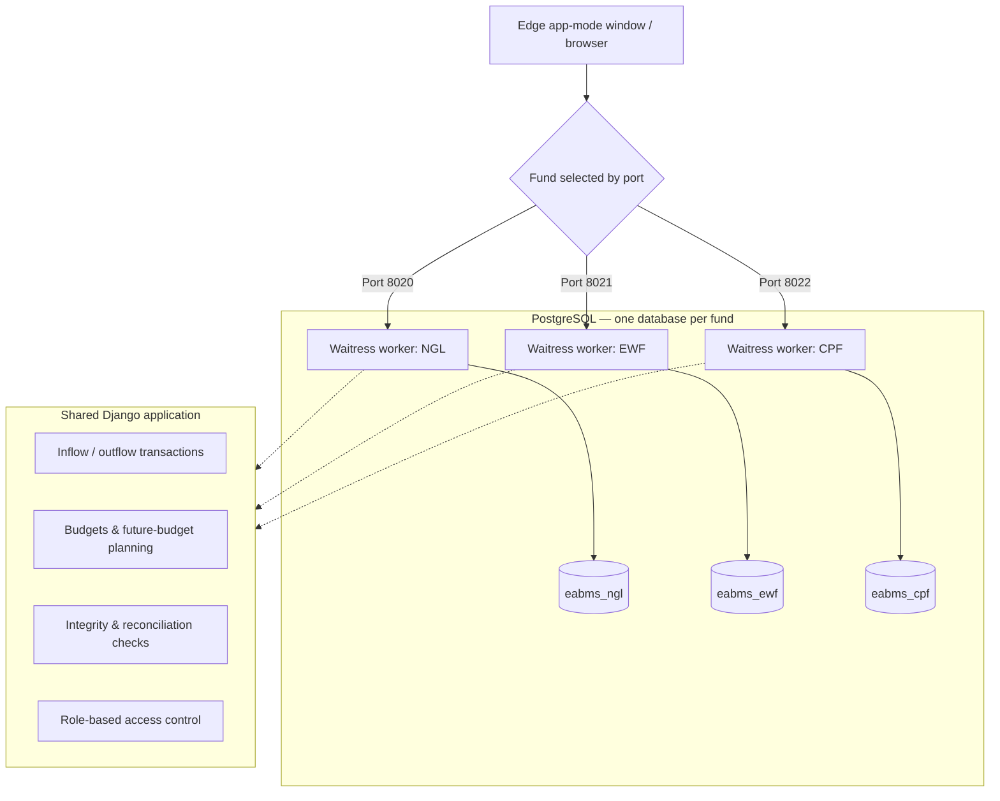

# Enterprise Accounts & Business Management System (EABMS)

[](https://www.python.org/)
[](https://www.djangoproject.com/)
[](https://www.postgresql.org/)
[](https://tailwindcss.com/)
[](https://docs.pylonsproject.org/projects/waitress/)
[](#testing)

> **Multi-fund accounting, budgeting and reporting for organisations that still run their finances on spreadsheets.**
> Runs offline on a single Windows PC or a LAN, with one-click launchers for non-technical staff.

All data in this repository is **synthetic demo data** (the fictional *NexGen Holdings Ltd.*).

---

## What it does

EABMS records the inflows and outflows of several separately managed funds, controls them against approved budgets, helps prepare next year's budget, and produces management reports — while keeping each fund's data in its own database.

### Key highlights
- **Three isolated funds, one codebase** — `NGL`, `EWF` and `CPF` each run as their own instance on their own port, with a dedicated PostgreSQL database.
- **Structured chart of accounts** — sub-funds → account heads → sub-heads, with inflow types, outflow natures and pass-through flagging.
- **Budget control and planning** — approved budgets with line-level revision history, plus a next-year planning workspace with system-suggested figures, known changes, staffing inputs and a decision log.
- **Reporting** — 15 built-in reports with PDF and Excel export, and a formatted Word budget-analysis paper.
- **Data integrity** — import de-duplication, reconciliation checks and backup/restore commands.
- **Windows-first deployment** — Waitress WSGI server, background launchers and Microsoft Edge app-mode windows.

---

## System architecture



| Code | Fund | Purpose | Port | Database |
| :--- | :--- | :--- | :--- | :--- |
| **NGL** | NexGen Holdings Ltd. | Primary operating account | `8020` | `eabms_ngl` |
| **EWF** | Employee Welfare Fund | Staff welfare, including employee Hajj/Umrah travel programmes | `8021` | `eabms_ewf` |
| **CPF** | Corporate Provident Fund | Provident fund, including corporate ceremonies and events | `8022` | `eabms_cpf` |

---

## Features

### Transactions
- Inflow and outflow entry against account heads, sub-funds and sub-heads.
- Internal transfers between sub-funds, with pass-through transactions shown separately.
- Reimbursement tracking (expected, received and pending amounts).
- Attribution of each transaction to branches and departments, including split allocations.
- Bulk edit and supporting-document uploads linked to transactions.
- CSV/Excel import with source fingerprinting to block duplicate imports.

### Budgets
- Approved budgets by account head or sub-fund, with a revision history for every line.
- **Future-budget planning:** suggested figures derived from historical spending, known changes, staffing inputs, management overrides and a decision history.
- A generated Word (`.docx`) budget-analysis paper with variance tables and annexes.

### Reports
Account summary, monthly inflows and outflows, monthly trend, budget vs actual, budget utilisation, routine vs additional outflows, account-head, sub-head and sub-fund summaries, financial-year summary, pass-through summary, reimbursements and year-on-year comparison — exportable to **PDF** (ReportLab) and **Excel** (OpenPyXL).

### Fund-specific modules
- **EWF:** travel cohorts, package pricing, traveller records and tour operators.
- **CPF:** ceremony venues and events.

### Integrity and operations
- Reconciliation checks for opening balance + inflows − outflows, sub-fund distribution and reimbursements.
- Management commands: `abms_backup`, `abms_restore`, `abms_preflight`, `security_integrity_check`.

---

## Security and access control

| Role | Can do |
| :--- | :--- |
| **Administrator** | System configuration, user management, master data, data administration |
| **Accounts Clerk** | Transaction entry, imports, document uploads, standard reports |
| **Senior Management** | Budget approval, planning decisions, executive reports |

- Secrets and database credentials are read from environment variables (`.env`); production start-up refuses to run without `DJANGO_SECRET_KEY`, `DJANGO_ALLOWED_HOSTS` and a database password.
- Django's ORM, CSRF and template auto-escaping protect against SQL injection, CSRF and XSS.
- User-management actions are recorded in an audit log.

---

## Quick start

### Option A — try it in five minutes (SQLite, no PostgreSQL)

```powershell
cd 02_Backend
python -m venv venv
.\venv\Scripts\Activate.ps1
pip install -r requirements.txt

python manage.py migrate
python manage.py seed_eabms_corporate
python manage.py seed_eabms_ewf_masters
python manage.py seed_eabms_cpf_masters
python manage.py seed_eabms_demo_transactions
python manage.py seed_eabms_demo_budget
python manage.py runserver 8020
```

With no `.env` file the app runs in development mode on SQLite. Open http://127.0.0.1:8020/ and sign in with a demo account below.

### Option B — Windows deployment (PostgreSQL)
1. `copy 02_Backend\.env.example 02_Backend\.env` and set the secret key and database password. Amounts display in rupees (`Rs`); set `ABMS_CURRENCY_SYMBOL` in `.env` to change it.
2. Run **`Start-All.bat`** (or `Start-NGL.bat`, `Start-EWF.bat`, `Start-CPF.bat`).
3. Each fund opens in its own window at ports 8020 / 8021 / 8022. Stop with **`Stop-All.bat`**.

### Demo credentials

| Username | Password | Role |
| :--- | :--- | :--- |
| `admin` | `admin123` | Administrator |
| `clerk` | `clerk123` | Accounts Clerk |
| `management` | `management123` | Senior Management |

These exist only in the seeded demo database. Change them before any real use.

---

## Testing

```powershell
cd 02_Backend
pytest
```

219 tests cover fund isolation, budget allocation and revision logic, future-budget suggestions, imports, reports and exports, organisational attribution, user management and production-hardening settings.

---

## Project layout

```text
EABMS/
├── 02_Backend/
│   ├── abms_config/     # Settings, URLs, WSGI; fund/port/database selection
│   ├── accounts/        # Authentication and user management
│   ├── core/            # Transactions, budgets, planning, imports, integrity checks
│   ├── masters/         # Master data and fund-specific modules
│   ├── reports/         # Report registry and PDF/Excel exporters
│   ├── templates/       # Tailwind CSS + HTMX interface
│   ├── static/          # CSS, JavaScript and icons
│   └── tests/           # Automated tests (pytest + Django TestCase)
├── DEPLOYMENT/Windows/  # PowerShell launcher and uninstaller
├── Start-*.bat / Stop-All.bat / EABMS-*.vbs   # One-click Windows launchers
└── README.md
```

---

## Author

- **GitHub:** [@Rizkayani19](https://github.com/Rizkayani19)
- Python/Django developer building business, records and finance applications for offline and LAN environments.
